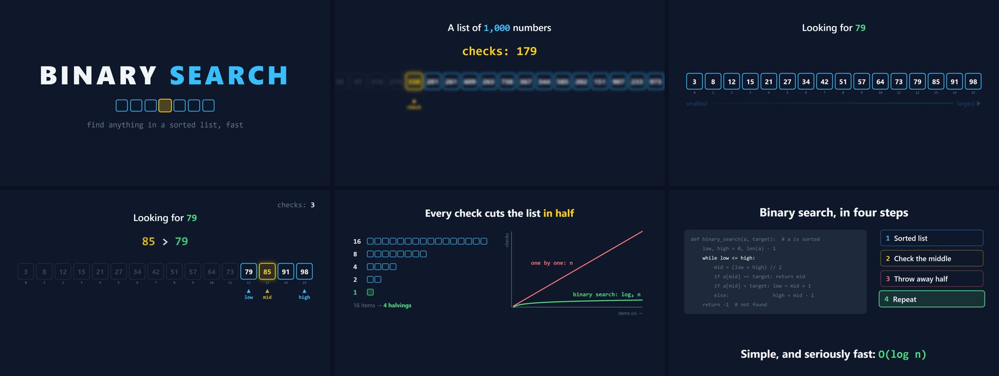

# 🎬 Binary Search: an Explainer Video Made with a Coding Agent

**Agentic Programming · Lab 6: Make an Explainer Video**

A 66-second narrated explainer on **binary search**, made entirely in code with Claude Code. The animation is [Remotion](https://www.remotion.dev/) (React → MP4), the voice is local [Kokoro](https://github.com/thewh1teagle/kokoro-onnx) text-to-speech, and every visual is drawn with divs and SVG. There are no generated images.



▶️ **Watch:** [`media/binary-search-explainer.mp4`](media/binary-search-explainer.mp4) (720p, 1.4 MB)

> **Takeaway:** Binary search finds an item in a sorted list by checking the middle and throwing away half the list each step, so it needs only about log₂(n) checks: 20 checks for a million items.

## Scenes

| # | Scene | What you see |
|---|---|---|
| 0 | [Title](src/scenes/Scene0Title.tsx) | "BINARY SEARCH" with a row of cells whose middle one lights up |
| 1 | [Hook](src/scenes/Scene1Hook.tsx) | A 1,000-item list scanned one by one, with the counter racing to 1,000 |
| 2 | [Sorted is the key](src/scenes/Scene2Sorted.tsx) | 16 scrambled cells sort themselves. Target: 79 |
| 3 | [First check](src/scenes/Scene3FirstCheck.tsx) | `low` / `mid` / `high` pointers. 42 < 79, so the left half is thrown away |
| 4 | [Repeat](src/scenes/Scene4Repeat.tsx) | 73 → 85 → 79 found: 4 checks instead of up to 16 |
| 5 | [Why it's fast](src/scenes/Scene5WhyFast.tsx) | 16 → 8 → 4 → 2 → 1, a chart of n vs log₂ n, then 1,000,000 → 20 |
| 6 | [Recap](src/scenes/Scene6Recap.tsx) | Python code with four step cards that light up the matching lines. O(log n) |

The full script, with narration and timings, is in [`SCRIPT.md`](SCRIPT.md).

## How it works

- **Narration first.** [`narration.json`](narration.json) holds the text for each scene. [`tts/narrate.py`](tts/narrate.py) turns it into `public/audio/<scene>.wav` and writes [`src/durations.json`](src/durations.json), so **every scene's length follows its audio**.
- **Animation cues sync to the speech.** Pauses in each clip were measured with `ffmpeg silencedetect`, and each scene's `CUE` table times its animations to those moments.
- **One scene per file.** Each scene is its own file, so two agent sessions could build scenes in parallel without conflicts. [`src/Main.tsx`](src/Main.tsx) strings them together with `<Series>` and `<Audio>`.
- **Shared pieces.** The colors and fonts are in [`src/theme.ts`](src/theme.ts), the example array is in [`src/data.ts`](src/data.ts), and the reusable array row with its pointers is in [`src/components/ArrayRow.tsx`](src/components/ArrayRow.tsx).

## Build it yourself

Requires Node 18+, Python 3.10+ and ffmpeg.

```sh
npm install
py -3.11 -m venv .venv                      # or: python3 -m venv .venv
.venv/Scripts/pip install kokoro-onnx soundfile
# download kokoro-v1.0.onnx and voices-v1.0.bin into models/
#   (https://github.com/thewh1teagle/kokoro-onnx/releases)
npm run narrate                             # regenerate the narration (optional; the .wav files are committed)
npm run studio                              # live preview at http://localhost:3000
npm run render                              # → out/video.mp4
```

## Process

The video was built in small steps with a commit after each one: setup and a 5-second test clip, then one scene per commit, each previewed in Remotion Studio and checked against the audio before moving on. Two Claude Code sessions worked side by side: one wrote the script, the narration and Scenes 1–2, and the other built the shared row component and Scenes 3–6. `git log` shows the whole sequence.

---

Part of my **Agentic Programming** labs (HUJI, AICODE 67723):
[Lab 1 · CTF Arena](https://github.com/hadarwolf/agentic-programming-lab1) · [Lab 2 · LLM failure modes](https://github.com/hadarwolf/agentic-programming-lab2) · [Lab 3 · Coin Dash with several agents](https://github.com/hadarwolf/agentic-programming-lab3) · [Lab 4 · Traffic monitor spec](https://github.com/hadarwolf/agentic-programming-lab4) · [Lab 5 · Chess: testing new features](https://github.com/hadarwolf/agentic-programming-lab5) · **Lab 6 · Binary search explainer video**
